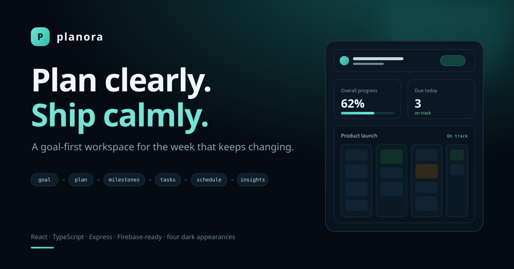

# Planora

**Plan clearly. Ship calmly.** Planora is a goal-first planning workspace for people juggling more than one outcome. It turns a goal into a plan, a plan into milestones and tasks, and those tasks into a schedule, a progress signal, and an honest picture of what needs attention.

**Live demo:** https://planora-zlxv.onrender.com



The demo is fully usable without an account. Signed-in users can opt into per-user cloud sync when Firebase is configured.

## Why this exists

Most planning tools are either a task list with no outcome, or a project tool that assumes a team and a methodology. Planora sits in between: a personal, multi-plan workspace where the question is always *“which goal is this work serving, and is it still on track?”*

The whole product is one loop:

**goal → plan → milestones → tasks → schedule → progress → insights**

Every view is a way into that loop rather than a separate demo screen.

## Review it in five minutes

1. **Dashboard** — four derived signals (progress, due today, active plans, open effort), the active plans with health, the next five deadlines, and recent activity. Nothing on this page is hand-authored sample text; it is computed from the workspace.
2. **Today** — overdue, due-today and upcoming work, with total open effort.
3. **Plans** — pick a plan, change its status, edit it, or open its milestones and tasks. Plan health is derived from dates and completion.
4. **Tasks** — a five-stage Kanban (Backlog, To Do, In Progress, Blocked, Complete). Drag a card on desktop, or use the explicit Move control on any device.
5. **Roadmap and Calendar** — the same work seen as a sequence and as a month.
6. **Insights** — completion, remaining effort, milestones achieved, and per-plan progress.
7. **Theme** — the control in the bottom-right switches between Midnight, Aurora, Ember and Graphite. The whole workspace repaints; layout and spacing do not move.

## Product surface

**Plans and milestones**

- Multiple plans with goal, description, dates, priority, category and colour
- Smart starter generation that turns a goal and timeline into editable milestones and starter tasks
- Manual plans built up with first-class milestone creation
- Plan editing, status transitions, archive/completion states, and confirmed cascade deletion
- Health derived from deadlines and task completion rather than hard-coded labels
- Roadmap sequencing with dependency order and milestone completion

**Tasks and workflow**

- Five-stage workflow: Backlog, To Do, In Progress, Blocked, Complete
- Task creation and editing with plan, milestone, status, priority, due date, estimate, tags and notes
- Confirmed deletion with dependency and note-reference cleanup
- Desktop drag-and-drop plus explicit move controls that stay usable on touch
- Overdue, due-today and upcoming grouping in Today

**Time, context and insight**

- Current-month calendar populated from task due dates, with Monday/Sunday week start
- Resources attached to plans or milestones, plus first-class plan notes
- Desk-wide search across plans, tasks, milestones, resources and notes (`Ctrl/Cmd + K`)
- Insights for completion, open effort, milestones and per-plan progress
- Workspace settings for week start, default estimate, compact density and attention indicators

**Workspace and persistence**

- Workspace export and a confirmed one-click demo reset
- Local-first guest workspace, versioned and scoped
- Google authentication plus per-user Firestore sync when Firebase is configured
- Defensive normalisation and repair of persisted workspace data
- Branded runtime recovery instead of a blank screen

## Design and theming

Planora has four persisted dark appearances, all built on one token set:

| Appearance | Character | Canvas | Accent |
| --- | --- | --- | --- |
| Midnight | Deep indigo, electric violet | `#090d18` | `#7c83ff` |
| Aurora (default) | Deep navy, focused teal | `#040b12` | `#43d6c5` |
| Ember | Warm graphite, coral | `#130d0c` | `#ff8568` |
| Graphite | Low-glare charcoal, silver | `#07090d` | `#8296ad` |

Switching appearance updates `html[data-theme]`, `color-scheme` and the browser `theme-color`, and stores the choice under `planora-theme-v2`. Surfaces, borders, text, accent, positive and warm tokens change; spacing, radii, type scale and component structure are declared once, so the workspace repaints without reflowing.

The appearance layers load in a deliberate order: the base layout, the four palettes, the visual direction expressed in tokens, and a final coverage layer for older rules that still carried literal colour values. That last layer is a documented migration seam, not a second design system.

Full notes: [`docs/DESIGN.md`](docs/DESIGN.md).

The layout reflows in clear steps: five workflow columns and three-up plan cards on wide screens, horizontally scrolling workflow columns at tablet widths, and a stacked workflow with off-canvas navigation, bottom-sheet forms and a two-up stat band on phones.

## Demo data

The sample workspace is generated relative to the day it is opened, so the demo always opens with a believable mix: a couple of overdue items, work due today, milestones ahead, two healthy plans and one at risk. It never drifts into “everything is late because the sample was written months ago”. Reset restores that state; Export saves the current one as JSON.

## Recruiter / portfolio quality pass

The public demo is designed to survive exploratory use rather than a scripted click path.

- Responsive layouts cover wide desktop, laptop/tablet, phone, narrow phone, coarse-pointer, reduced-motion, zoom and safe-area cases
- The mobile Kanban becomes a stacked workflow instead of a desktop board squeezed into a phone viewport
- Touch targets are enlarged for task state, edit/delete, milestone, navigation, calendar, resources and primary actions
- Modals become bottom-sheet forms on phones with native-size inputs that avoid browser zoom
- Long user-entered labels, task names, resources, notes and milestones are constrained so content cannot tear the layout apart
- Destructive plan, task and reset operations require confirmation; plan deletion cleans related domain references
- Persisted JSON is normalised entity by entity; malformed references are repaired or dropped, invalid URLs and dates are contained, and collection sizes are bounded
- Local calendar dates are calculated from local time rather than UTC string slicing
- Express removes framework disclosure and adds CSP, frame protection, HSTS, permissions restrictions, MIME-sniffing protection, referrer policy and production cache rules
- Firestore rules restrict workspace documents to the authenticated user, the expected path, the expected top-level shape, and bounded collections
- No application secrets are committed

## Stack

**Frontend:** React 19, TypeScript, Vite, Lucide, custom responsive/themed CSS  
**Auth / cloud persistence:** Firebase Authentication + Firestore  
**Local persistence:** versioned browser workspace with legacy migration, normalisation, referential repair and scoped storage  
**Hosting:** Express 5 on Render  
**Quality:** strict TypeScript, GitHub Actions, deterministic dependency versions, production build verification and server smoke testing

## Run locally

Requires Node `22.16+`.

```bash
npm install
npm run dev
```

The Vite client runs at `http://localhost:5173`. Planora stays fully usable without credentials and stores guest workspace changes locally.

Full preflight:

```bash
npm run check
npm run smoke:server
```

`npm run check` typechecks both TypeScript targets, creates the production client/server builds, and verifies required build artefacts. `npm run smoke:server` boots the compiled Express host and checks the production health/API contract.

## Firebase configuration

Copy `.env.example` to `.env` and configure:

```env
VITE_FIREBASE_API_KEY=
VITE_FIREBASE_AUTH_DOMAIN=
VITE_FIREBASE_PROJECT_ID=
VITE_FIREBASE_APP_ID=
```

Enable Google as a sign-in provider in Firebase Authentication and deploy the repository's `firestore.rules` before using Firestore in production.

When Firebase is not configured, authentication controls degrade into a clearly labelled local demo instead of causing startup failure.

## Persistence model

Planora uses a local-first strategy:

1. Guest state is read from a versioned, scoped `localStorage` workspace.
2. Persisted content is normalised before it reaches the UI; malformed entities and dangling references are repaired or discarded safely.
3. Legacy workspace data is migrated when possible.
4. Signed-in users load their `/users/{uid}/workspaces/default` Firestore document.
5. Workspace changes are saved locally immediately and cloud-synced after a short debounce.
6. Cloud failures leave the local workspace usable and visibly report the fallback state.

This keeps the public portfolio demo frictionless while demonstrating a realistic authenticated persistence boundary.

## Production host

The Express server exposes:

- `GET /api/health` — service health and runtime mode
- `GET /api/config` — non-secret Firebase readiness

Static assets receive long-lived immutable caching, the SPA document remains uncached, API responses are `no-store`, and unknown `/api/*` paths return JSON 404s instead of falling through to the SPA.

## Engineering docs

- [`docs/ARCHITECTURE.md`](docs/ARCHITECTURE.md) — domain model, state ownership, auth/persistence boundaries and production shape
- [`docs/DESIGN.md`](docs/DESIGN.md) — product loop, visual direction, appearance tokens, layer order and responsive contract
- [`docs/DEPLOYMENT.md`](docs/DEPLOYMENT.md) — local, Render and Firebase deployment runbook
- [`docs/QA.md`](docs/QA.md) — functional, responsive, accessibility, persistence and API acceptance checklist
- [`docs/PROJECT_MAP.md`](docs/PROJECT_MAP.md) — quick map of the files that own UI, state, auth, hosting and deployment

## Deployment

The repository is configured for Render with Node `22.16.0`, a full `npm run check` build gate, `npm start`, and `/api/health` health checks. GitHub Actions runs the same build contract plus the production server smoke test on pushes and pull requests.

## What this project demonstrates

Planora is meant to show more than visual polish. It demonstrates derived state, workflow transitions, typed domain modelling, editable CRUD flows, safe destructive operations, local/cloud persistence, auth-aware state boundaries, graceful failure handling, browser-storage migration and repair, a four-appearance token system, responsive product design, accessibility considerations, defensive production hosting, Firestore authorisation rules, CI, and deployable full-stack structure.
